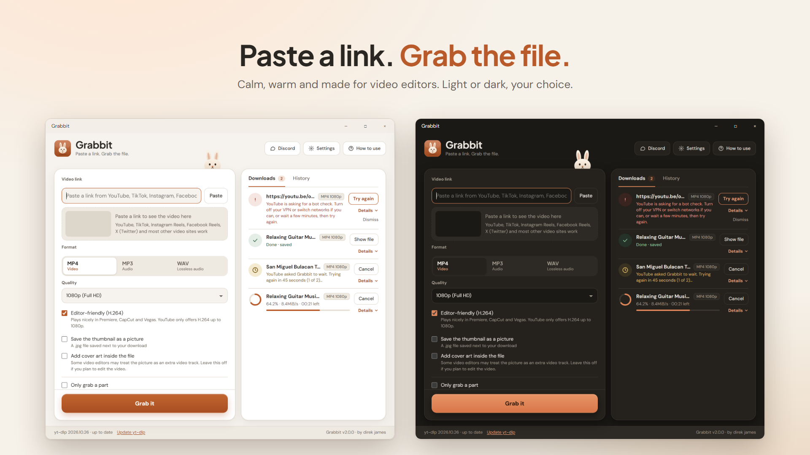
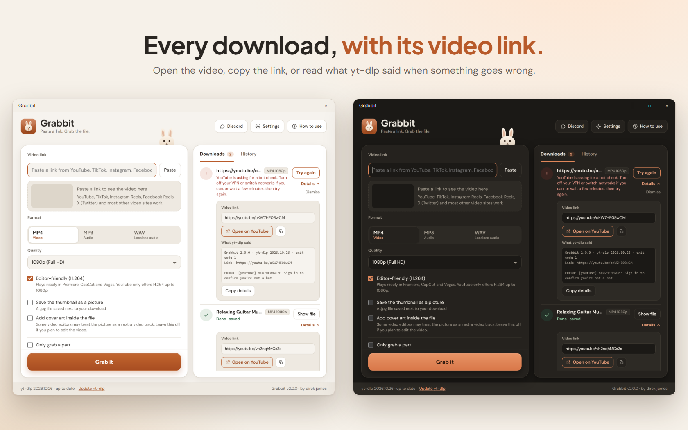

# Grabbit 🐇

**Paste a link, grab the file.**

## About

Grabbit is a free Windows app for downloading video and audio as MP4, MP3 or WAV, made for video editors.

Paste a link, pick a format and press **Grab it**. You can download a whole video, a whole playlist, or just a short part of one.

## Features

- MP4 video from 360p up to 4K, with an **Editor-friendly (H.264)** option that plays nicely in Premiere, CapCut and Vegas
- MP3 audio (128 to 320 kbps) and lossless WAV
- **Only grab a part:** set a From and To time to download just a sound effect or a short clip
- Whole-playlist downloads, saved into a folder per playlist
- Several downloads at once, with progress, speed and time left. Choose how many run together (1 to 5) and the rest wait in line
- **Details on every download:** the video link with an **Open on YouTube** button (or the site it came from) and a Copy link button. A failed download also shows what yt-dlp said, so bug reports are easy to write
- **Try again** on failed downloads (half-finished files pick up where they stopped), and an automatic wait and retry when YouTube asks for a bot check
- History with a "Show file" button
- **Light and dark mode:** light by default, with a switch in Settings
- Download progress on the Windows taskbar button
- Works with YouTube, **TikTok, Instagram Reels, Facebook Reels and X (Twitter)**, and most other video sites
- **Thumbnail saver** (a .jpg next to the download) and **cover art** inside your MP3s
- A notification and a sound when a download finishes
- **Sign-in help** for Instagram and Facebook, using the browser you are already logged in with
- **Languages:** English, Filipino, Cebuano, Hiligaynon, Pirate and Enchanting Table
- A built-in **How to use** guide (top-right button, or press F1) that opens by itself the first time
- Keeps working when sites change: the downloader updates itself quietly (at most twice a day, and you can switch it off), warns you if it gets old, and Grabbit updates itself too

## Getting started

1. Go to the [Releases page](https://github.com/direkjames/Grabbit/releases) and download the latest file.
   - **Grabbit-Setup** installs the app with desktop and Start menu shortcuts.
   - **Grabbit-Portable** is one file you can run from anywhere, even a USB stick.
2. Open it. If Windows shows "Windows protected your PC", click **More info**, then **Run anyway**. It only happens once, because the app is not code-signed.
3. Paste a video link and pick **MP4**, **MP3** or **WAV**.
4. Press **Grab it**. Your files are saved in `Downloads\Grabbit` by default, and you can change the folder in the app.

Some antivirus programs flag downloader tools by mistake. That is a known false positive.

## Requirements

- Windows 10 or 11 (64-bit)
- An internet connection
- Nothing else to install

## Built with

- [Electron](https://www.electronjs.org)
- [yt-dlp](https://github.com/yt-dlp/yt-dlp)
- [FFmpeg](https://ffmpeg.org)
- [Deno](https://deno.com)
- [DM Sans](https://fonts.google.com/specimen/DM+Sans) and [Plus Jakarta Sans](https://fonts.google.com/specimen/Plus+Jakarta+Sans), bundled in the app (SIL Open Font License)

Want to build it yourself? See [Developing Grabbit](docs/DEVELOPING.md).

## Status

Shipped.

## Credits / License

MIT © 2026 direk james. The bundled tools keep their own licenses (see `LICENSE`).

Please only grab content you have the right to use: your own uploads, Creative Commons or royalty-free material, or clips used within your local fair-use rules. Downloading may be against the Terms of Service of some sites.
